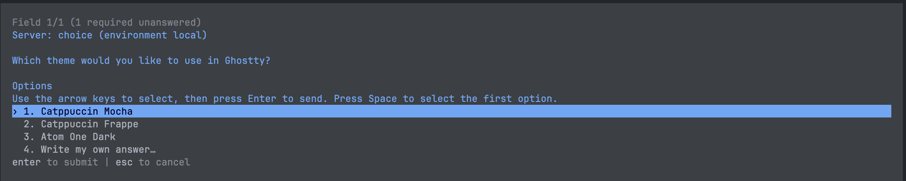

# Ask User for Codex

Give Codex a question it can hand back to you. Ask User opens a multiple-choice form in a supported Codex chat and waits for your answer. You can pick an option, type your own answer, or cancel.

## Why we built it

We wanted the keyboard-driven choice we liked in Pi inside our Codex chat. When Codex printed a numbered list, pressing an arrow key or Enter in the conversation didn’t select a line. We had to type the answer back, even when it was already on screen. That friction mattered most when Codex was ready to act and the next step depended on our preference.

Ask User gives that decision its own form. The selected text goes back to Codex. Cancelling leaves the decision open.

## Choosing a terminal theme

Suppose you want to change your Ghostty theme. In a new Codex chat, try this prompt.

> Use Ask User to let me choose between Catppuccin Mocha, Catppuccin Frappe, and Atom One Dark. Wait for my answer, then show me the Ghostty config line.

The screenshot shows **Catppuccin Mocha** highlighted. Press **Enter** to submit it, or use the arrow keys to choose another theme.



Codex can then show the Ghostty config line.

```ini
theme = Catppuccin Mocha
```

To enter a different theme, choose **Write my own answer…** and type its name in the next field. The plugin only returns your answer. In this example, Codex shows the configuration and your Ghostty settings stay as they were.

## Install

You need Node.js 22 or later on your PATH and a Codex client that supports MCP form elicitation. The repository includes the built server, so users can install directly.

```sh
codex plugin marketplace add umit/codex-ask-user
codex plugin add ask-user@codex-ask-user
```

Start a **new chat** after installation so Codex loads the tool. If you see a plain-text list, explicitly ask Codex to use the Ask User plugin. If the client does not support forms, the tool reports that to Codex. The accompanying skill then asks Codex to use a native question card when one is available.

## Develop

Run these commands from a clone of this repository.

```sh
npm ci
npm run build
npm test
```

Edit `plugins/ask-user/src/server.mjs` to change the tool and `plugins/ask-user/skills/ask-question/SKILL.md` to change when Codex uses it. Rebuild after source changes and commit the resulting `bin/server.cjs` with the source. The tests launch that bundle over MCP stdio and exercise the question-and-answer flow.
